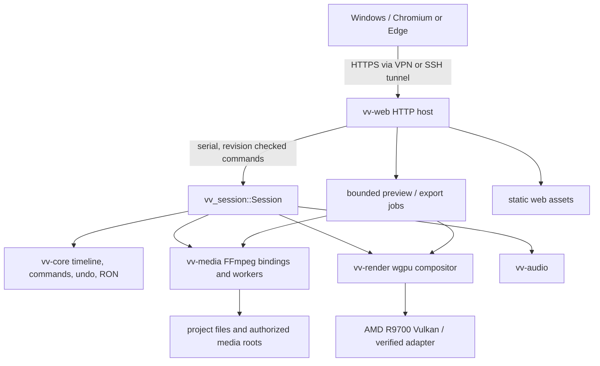

# Venturi Web — architecture and boundaries

## C4 context (target)



## Concrete upstream facts checked

- `Cargo.toml` declares `vv-core`, `vv-media`, `vv-render`, `vv-audio`, `vv-session`, `vv-vad`, `vv-mcp`, `vv-app`; there is **no `vv-web` yet**.
- `vv-session/src/session.rs`: `Session` owns `Project`, `History`, path and per-timeline `timeline_revision()`; edits use `apply(Box<dyn Command>)`; saves use `save_to()`.
- `vv-mcp` is a tool adapter using stdio and a host channel; `vv-app mcp` runs headless. It is not a REST server. `get_state` and `screenshot_ui` are attached desktop-only.
- `vv-session/frame_provider.rs` and `export.rs` are entry points for frames and export; inspect exact APIs before code.
- `vv-app/src/render_ahead.rs`, `mix_buffers.rs`, `proxy_worker`, `waveform_worker`, `transport.rs`, `slip_viewer.rs` own significant preview orchestration. Reuse/extract judiciously, not copy/paste the entire app.
- UI preview renders GPU texture into egui without readback; export does readback/encode. Browser preview therefore needs new work.
- `vv-core` uses frame integers in timeline FPS; source frame conversions are centralized. Never use floating-point seconds as edit authority.

## Target layout (new paths, pending Gate 0)

```text
crates/vv-web/                 # new crate added to workspace only in milestone M1
  src/main.rs                 # bind + graceful shutdown
  src/api.rs                  # request/response routing, no editing business rules
  src/host.rs                 # single owner Session actor + command dispatcher
  src/commands.rs             # request validation and safe-edit plans
  src/preview.rs              # bounded single-frame jobs first
  src/export.rs               # bounded async jobs, explicit states
  src/media.rs                # allowlisted project/media resolution
  src/events.rs               # SSE status / progress
  src/tests/...               # project convention; see AGENTS.md
web/
  index.html
  style/tokens.css
  style/app.css
  js/main.js
  js/state.js
  js/api.js
  js/commands.js
  js/timeline/{geometry,draw,input}.js
  js/viewer.js
  js/panels/{media,inspector,effects,history}.js
  js/workspaces/{edit,color,audio,review}.js
  test/...                    # browser logic fixtures and tests
```

These are **recommended boundaries**, not mandatory names. Simplify if the real source reveals a better seam. Do not add files for hypothetical abstractions.

## Ownership and concurrency

- Server: single `Session` actor handles mutations sequentially. Reads may use snapshots; slow frame/export work runs on immutable project snapshots with bounded concurrency. No Session mutex held across GPU blocking work.
- One project may have many timelines. Each command records expected project epoch AND timeline revision, if applicable.
- Client: `documentState` is confirmed server snapshot; `viewState` is selection/playhead/layout; `gestureState` is ephemeral drag. Optimistic visual draft is not a persisted edit.
- Preview jobs keyed by `(session_epoch, timeline_revision, frame, resolution, effect context)` and assigned monotonically increasing `request_seq`. Discard stale responses; cancellation is best-effort; bound queue and budgets.
- On commit, verify current revision before any destructive plan; execute atomically and return new revision + affected ids. For ambiguous disconnects, idempotency keys and operation lookup prevent duplicate edits.
- Export operates on an immutable snapshot. Only one at a time until verified otherwise; closing browser does not stop it.

## Architectural alternatives rejected for M0–M2

- React / Redux / component framework: adds runtime/dependency surface without a proven need; revisit if vanilla produces duplicated lifecycle logic.
- Browser-side second editing engine: would diverge from Venturi and break frame/undo semantics.
- Shelling out to system `ffmpeg` for normal editing: duplicate engine. Optional diagnostic/transcoding tools may be permitted with an explicit reason.
- Building the entire core in WASM: wrong GPU / storage locality for this remote-Linux objective.
- WebRTC first: too much signaling, synchronized media and maintenance before playback needs are measured.
- Synchronous `render_frame` per pointer move: GPU/network pressure, no interactive preview cache.
- MCP as permanent per-gesture transport: acceptable for an initial experiment; use direct Session APIs for stable web host and deep parity.

## Implementation rules

1. Add as little code to existing crates as possible; extract reusable playback services from `vv-app` only with focused upstream-preserving tests.
2. Never modify `.vvproj` representation for AI Shot/Take metadata in v1. Store companion metadata separately, versioned and referenced by stable media ids; validate relink behavior.
3. Avoid hidden mutable globals. No DOM virtual framework. No generic event bus or DI framework. Prefer direct module APIs.
4. GPU selection via explicit, verified Vulkan adapter; actual R9700/8060S device names, PCI IDs and driver behavior established by probe.
5. Preserve original upstream GPL license notices and honor redistribution obligations. Brand artwork is linked, not vendored in pack.

## Non-goals for initial release

Multiuser collaboration, browser media editing engine, node editor, speed ramp/reverse/freeze (upstream not currently implemented), distributed GPU scheduling, direct internet publishing, mobile UI, full live WebRTC, cloud account system.

## Open technical spikes (must close before implementing each dependent feature)

- Headless wgpu device creation with R9700 under SSH, Vulkan permissions + no desktop.
- Exact `vv-session` frame render API and headless exposure; cost and color correctness.
- Move/insert safety with linked clips, lock states and undo atomicity.
- How export snapshots are scheduled, cancelled and persist across browser disconnection.
- Can a paused source proxy be served directly with proper range support and licensing?
- Audio preview/voiceover clock and capture semantics from Windows browser.
